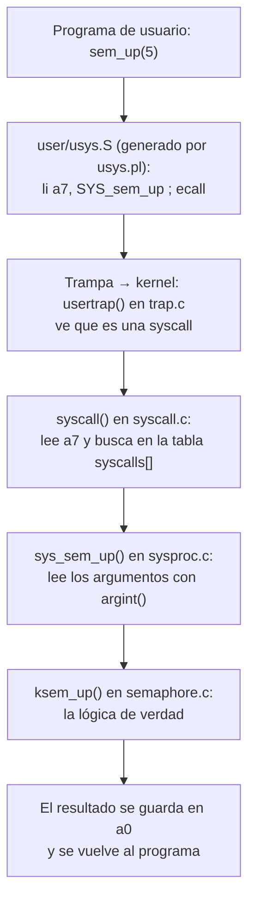
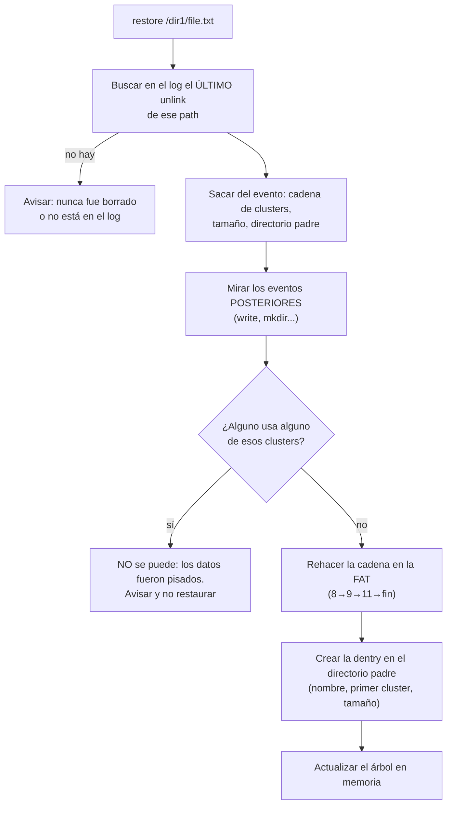

> **De dónde sale esto.** El Lab 3 está armado con el enunciado de la cátedra ("Sistema de Auditoría Forense para FAT32-FUSE"), el README del código y tu `INFORME.md`. Del Lab 2 no hay enunciado en la compu, así que está armado con tu código (`semaphore.c`, `pingpong.c`, `prodcons.c`), el código que dio la cátedra (`semtest.c`) y los tests con los que corrigen (`lab2_tests.py`). Donde algo es una decisión de tu grupo y no una regla del enunciado, está aclarado.

---

# PARTE A — Laboratorio 2: semáforos en xv6

## 1. Qué es xv6 y dónde corre

### 1.1 La idea, en criollo
**xv6** es un sistema operativo de juguete hecho por el MIT para enseñar. Es una versión moderna y chiquita del Unix de los años 70: tiene procesos, `fork`, `exec`, `wait`, pipes, un sistema de archivos y un shell. Todo eso pasa en unas pocas miles de líneas de C, así que se puede leer entero.

Es como una **maqueta de una casa**: no vivís ahí, pero tiene cañerías, cables y paredes de verdad, y podés abrirla para ver cómo está conectado todo.

- Está escrito para procesadores **RISC-V** (otra "familia" de procesadores, distinta de la x86 de tu compu).
- Como tu compu no es RISC-V, se corre adentro de **QEMU**, un programa que **emula** una computadora RISC-V completa. QEMU hace de "compu falsa" y xv6 bootea adentro como si fuera una máquina real.

### 1.2 Comandos que tenés que conocer
| Comando | Qué hace |
|---|---|
| `make qemu` | Compila el kernel y los programas de usuario, arma el disco (`fs.img`) y bootea xv6 en QEMU |
| `make grade` / `make grade-parcial` / `make grade-final` | Corren los tests de la cátedra (los mismos que usan para corregir) |
| `Ctrl-a` y después `x` | Salir de QEMU |
| `Ctrl-p` (dentro de xv6) | Imprime la lista de procesos (`procdump`): sirve para ver si alguien quedó dormido para siempre |
| `make clean` | Borra lo compilado |

> En tu `Makefile` QEMU corre con **una sola CPU** (`-smp 1`). Con una CPU nunca corren dos procesos *al mismo tiempo de verdad*, pero sí se **intercalan**, porque el kernel los cambia por interrupciones de reloj. Por eso los problemas de concurrencia aparecen igual.

---

## 2. Repaso: qué es un semáforo

### 2.1 La caja de fichas
Pensá en una **caja con fichas** y una fila de gente esperando.
- **`down`** (también le dicen `wait` o `P`): "quiero una ficha". Si hay alguna, la agarrás y seguís. Si la caja está vacía, te sentás a **dormir** hasta que alguien deje una.
- **`up`** (también `post`, `signal` o `V`): "dejo una ficha en la caja". Si había alguien durmiendo esperando, se lo despierta.

El **valor** del semáforo es la cantidad de fichas en la caja. En la implementación del lab el valor **nunca es negativo**: si llega a 0, el que hace `down` duerme y no resta.

### 2.2 Con cuántas fichas arranca: la regla de oro
El valor inicial dice **cuántos pueden pasar sin esperar**.

| Valor inicial | Para qué sirve | Ejemplo del lab |
|---|---|---|
| **1** | **Mutex** (exclusión mutua): de a uno por vez en la zona peligrosa | `sem_mutex` de `prodcons` |
| **0** | **Orden**: "vos esperás hasta que yo te avise" | `sem_pong` de `pingpong`, `sem_full` de `prodcons` |
| **B** | **Contar lugares**: hasta B a la vez | `sem_empty` de `prodcons` (B lugares libres en el buffer) |

Es lo mismo que el cap. 31 del libro (ver `Resumen Concurrencia`), pero ahora **lo implementás vos dentro del kernel**.

---

## 3. Qué se pidió: cuatro syscalls nuevas

### 3.1 La interfaz
```c
int sem_open(int sem, int value);  // abrir el semáforo "sem" con "value" fichas
int sem_up(int sem);               // dejar una ficha (y despertar a quien espera)
int sem_down(int sem);             // tomar una ficha (o dormir si no hay)
int sem_close(int sem);            // cerrar/liberar el semáforo "sem"
```

El semáforo se identifica con un **número** (en tu implementación, del 1 al 64). No es un puntero ni una variable del programa: es como el **número de un casillero** en una pared que está en el kernel. Dos procesos que usan "el casillero 5" están usando el mismo semáforo.

### 3.2 Qué hace cada una en cada caso (tu implementación)
| Llamada | Si sale bien | Si falla devuelve 0 cuando... |
|---|---|---|
| `sem_open(sem, value)` | Lo marca abierto con `value` fichas; devuelve `sem` | `sem` fuera de 1..64, `value < 0`, o **ya estaba abierto** |
| `sem_up(sem)` | Suma 1 y despierta a los que duermen; devuelve `sem` | fuera de rango, no está abierto, o llegó al máximo (1.000.000) |
| `sem_down(sem)` | Si hay fichas, resta 1 y sigue; si no, duerme hasta que haya. Devuelve `sem` | fuera de rango, no abierto, o **lo cerraron mientras dormía** |
| `sem_close(sem)` | Lo marca libre, valor 0, despierta a los que dormían; devuelve `sem` | fuera de rango o no estaba abierto |

- `up` **puede pasar el valor inicial**: si abrís con 0 y hacés tres `up`, queda en 3. Es el test `semtest grow`.
- Abrir dos veces el mismo número **se rechaza** (test `semtest reopen`). Gracias a eso un programa puede "buscar un casillero libre" probando números hasta que `sem_open` le dé bien (lo hace `sem_get` en pingpong y prodcons).

### 3.3 Lo que miran los tests de `semtest` (programa que dio la cátedra)
| Test | Qué prueba |
|---|---|
| `noinit` | `sem_down` sobre un semáforo nunca abierto → tiene que dar **error**, no colgarse |
| `init 3` | Abrir con 3 y que el valor sea 3 |
| `closeuse` | Después de `sem_close`, usarlo (`sem_up`) tiene que dar **error** |
| `exhaust` | Gastar la única ficha, cerrar y **volver a abrir** el mismo número (reutilizar) |
| `grow` | Hacer `up` más veces que el valor inicial |
| `reopen` | Abrir dos veces el mismo número → el segundo se **rechaza** |

Puntaje: syscalls 6, pingpong 5, prodcons 4 (total 15). La entrega intermedia (`grade-parcial`) eran syscalls + pingpong (11). El punto estrella (varios productores y consumidores) vale 0 puntos, es crédito extra.

---

## 4. Cómo se agrega una syscall en xv6 (el camino completo)

### 4.1 La analogía: la ventanilla del banco
Un programa de usuario **no puede tocar la memoria del kernel**: está del otro lado del vidrio. Para pedirle algo, completa un **formulario** (pone el número de trámite y los datos en lugares fijos) y toca el **timbre**. Del otro lado, un empleado lee el número de trámite, busca en una lista quién se encarga y le pasa los datos. La respuesta vuelve por el mismo lugar.

- El **timbre** es la instrucción **`ecall`** de RISC-V: produce una *trampa* (trap) y la CPU salta a **modo kernel**.
- El **número de trámite** va en el registro **`a7`**.
- Los **datos** (argumentos) van en los registros **`a0`, `a1`, ...** (en `sem_open(sem, value)`: `sem` en `a0`, `value` en `a1`).
- La **respuesta** vuelve en **`a0`**.

### 4.2 Los archivos que se tocan (en orden de viaje)


| Archivo | Qué se agrega | Para qué |
|---|---|---|
| `user/user.h` | `int sem_up(int sem);` | El **prototipo**: para que los programas de usuario compilen |
| `user/usys.pl` | `entry("sem_up");` | Genera el "**stub**" en assembler (`usys.S`) que pone el número en `a7` y hace `ecall` |
| `kernel/syscall.h` | `#define SYS_sem_up 24` | El **número de trámite** (en tu lab: 22 open, 23 close, 24 up, 25 down) |
| `kernel/syscall.c` | `extern uint64 sys_sem_up(void);` y `[SYS_sem_up] sys_sem_up,` | La **tabla** número → función |
| `kernel/sysproc.c` | `sys_sem_up()` | **Desempaqueta** los argumentos (`argint(0, &sem)`) y llama a la lógica |
| `kernel/semaphore.c` / `.h` | `ksem_up()` y compañía | La **lógica** del semáforo |
| `kernel/defs.h` | prototipos de `ksem_*` | Para que otros archivos del kernel puedan llamarlas |
| `kernel/main.c` | `seminit()` al bootear | Inicializar la tabla y los locks una sola vez |
| `Makefile` | `$K/semaphore.o` en `OBJS`; `$U/_pingpong`, `$U/_prodcons` en `UPROGS` | Compilar el archivo nuevo del kernel y meter los programas en el disco de xv6 |

### 4.3 ¿Por qué `argint` y no los parámetros normales de C?
Las funciones `sys_*` **no reciben parámetros** (`uint64 sys_sem_up(void)`). Los argumentos quedaron guardados en los registros del proceso cuando hizo `ecall` (en el **trapframe**, la "foto" de los registros que se guarda al entrar al kernel). `argint(n, &x)` va a buscar el registro `a_n` de esa foto. En esta versión de xv6, `argint` no devuelve nada (es `void`), así que la validación (que `sem` esté en rango, que `value` no sea negativo) la tenés que hacer vos.

---

## 5. Por dentro: cómo está hecho el semáforo

### 5.1 La estructura
```c
struct sem {
  int value;             // cuántas fichas hay
  int is_open;           // 1 si está en uso, 0 si está libre
  struct spinlock lock;  // el "patovica" que cuida este semáforo
};
struct sem sem_table[65];  // casilleros 1..64 (el 0 no se usa)
```

### 5.2 ¿Por qué tiene que vivir en el kernel?
Porque **los procesos no comparten memoria**. Después de un `fork()`, el hijo tiene una **copia** de la memoria del padre: si el semáforo fuera una variable común del programa, padre e hijo tendrían **cada uno la suya** y no se enterarían de nada de lo que hace el otro. El kernel es el único lugar que **todos** los procesos ven igual: por eso el semáforo es una syscall y vive en una tabla global del kernel.

### 5.3 El spinlock: el patovica de la puerta
Dos procesos podrían hacer `sem_down` sobre el mismo semáforo "a la vez" (o uno interrumpido en la mitad). Mirar el valor y restarle uno tiene que ser **atómico**: si no, los dos ven "queda 1 ficha" y los dos la toman.

Por eso cada semáforo tiene un **spinlock**:
- `acquire(&lock)`: "entro yo, nadie más". Si está ocupado, **espera dando vueltas** (spin = girar) preguntando una y otra vez. Además **apaga las interrupciones** en esa CPU mientras lo tiene, para que no lo saquen a la mitad.
- `release(&lock)`: "ya salí".

Un spinlock se tiene que soltar **rápido**: mientras alguien lo tiene, los demás gastan CPU dando vueltas. Por eso **no se puede dormir con un spinlock tomado y "olvidarse"**.

### 5.4 Dormir y despertar: `sleep` y `wakeup`
El `down` tiene que **dormir** si no hay fichas (no dar vueltas, eso gastaría CPU). xv6 trae dos funciones del kernel:

- **`sleep(canal, lock)`**: pone al proceso a dormir esperando en un "canal". El canal es solo un número que funciona de **etiqueta**: en el lab se usa la dirección del semáforo, `&sem_table[sem]`. Lo importante es que **suelta el lock y se duerme en un solo paso**, y cuando lo despiertan **vuelve a tomar el lock** antes de seguir.
- **`wakeup(canal)`**: despierta a **todos** los que duermen con esa etiqueta.

```c
int ksem_down(int sem) {
  acquire(&sem_table[sem].lock);
  ...
  while (sem_table[sem].value == 0) {            // WHILE, no if
    sleep(&sem_table[sem], &sem_table[sem].lock);
    if (!sem_table[sem].is_open) { release(...); return 0; }  // lo cerraron
  }
  sem_table[sem].value--;
  release(&sem_table[sem].lock);
  return sem;
}
```

**¿Por qué `sleep` recibe el lock?** Para evitar el **despertar perdido** (*lost wakeup*). Si primero soltaras el lock y después te durmieras, en el medio otro proceso podría hacer `up` y `wakeup`... cuando todavía no estabas dormido. Ese aviso se pierde y vos te dormís para siempre. Como `sleep` suelta el lock y duerme "de una", nadie puede meterse entre medio.

**¿Por qué `while` y no `if`?** Porque `wakeup` despierta a **todos** los que esperan, pero quizás hay **una sola ficha**. El primero que corre se la lleva; los demás, al despertarse, tienen que **volver a mirar** si hay fichas y, si no, dormir de nuevo. Con `if` pasarían de largo y el valor quedaría negativo. (Es lo mismo que la regla de las variables de condición del cap. 30.)

**¿Por qué `close` hace `wakeup`?** Si alguien está dormido en un semáforo que se cierra, nunca más lo despertaría nadie. `close` los despierta y `down` ve `is_open == 0` y devuelve error.

---

## 6. Programa `pingpong`: alternar dos procesos

### 6.1 Qué tiene que hacer
`pingpong N` imprime `ping` y `pong` **alternados**, N veces cada uno, y termina. Si no le pasás N, o N es inválido, imprime un mensaje que empieza con **`ERROR`**.

### 6.2 Cómo se resuelve
Dos semáforos, uno por "turno":
- `sem_ping` arranca en **1** → el que imprime `ping` puede empezar.
- `sem_pong` arranca en **0** → el que imprime `pong` tiene que esperar.

```c
// padre (ping)                      // hijo (pong)
for (i = 0; i < n; i++) {            for (i = 0; i < n; i++) {
    sem_down(sem_ping);                  sem_down(sem_pong);
    printf("ping\n");                    printf("pong\n");
    sem_up(sem_pong);   // tu turno      sem_up(sem_ping);   // tu turno
}                                    }
wait(0);                             exit(0);
sem_close(sem_ping); sem_close(sem_pong);
```

Es como pasarse **una sola pelota**: solo juega el que la tiene, y al terminar se la pasa al otro.

- El **padre espera al hijo** (`wait`) y **recién después cierra** los semáforos. Si cerrara antes, el hijo podría quedar haciendo `down` sobre un semáforo cerrado.
- El test de **concurrencia** corre `pingpong 10 &`, `pingpong 10 &` y `pingpong 20` **al mismo tiempo**. Si los semáforos tuvieran números fijos (siempre el 1 y el 2), los tres programas usarían los mismos casilleros y se mezclarían. Por eso se usa `sem_get`, que **busca un número libre** probando `sem_open` del 1 al 64.

---

## 7. Programa `prodcons`: productor y consumidor

### 7.1 Qué tiene que hacer
`prodcons B N`: un **productor** fabrica N ítems y un **consumidor** los usa, con un depósito (buffer) de capacidad **B**. Nunca puede haber más de B producidos sin consumir. Imprime `produce i` y `consume i`. Si faltan parámetros o son menores a 1, imprime `ERROR`.

### 7.2 Los tres semáforos
| Semáforo | Valor inicial | Significa |
|---|---|---|
| `empty` | **B** | lugares **libres** en el depósito |
| `full` | **0** | lugares **ocupados** (ítems listos para consumir) |
| `mutex` | **1** | de a uno por vez tocando el depósito |

```c
// productor                          // consumidor
sem_down(empty);   // ¿hay lugar?     sem_down(full);    // ¿hay algo?
sem_down(mutex);                      sem_down(mutex);
printf("produce ...");                printf("consume ...");
sem_up(mutex);                        sem_up(mutex);
sem_up(full);      // hay uno más     sem_up(empty);     // se liberó un lugar
```

### 7.3 El orden de los `down` importa
Primero se espera la **condición** (`empty` o `full`) y **después** se toma el `mutex`. Si lo hicieras al revés, el consumidor podría tomar el mutex, encontrar el depósito vacío y **dormirse con el mutex en la mano**. El productor nunca podría entrar a producir → **deadlock**. (Es exactamente el error de la Figura 31.7 del libro.)

### 7.4 Lo que chequean los tests
- `prodcons 1 5`: con B = 1 tiene que **alternar** produce/consume (nunca 2 producidos sin consumir).
- `prodcons 3 10`: nunca más de **3** "en vuelo" (producidos y sin consumir).
- Al final, todo lo producido fue consumido y el programa termina (aparece `DONE`).
- ⭐ Estrella: `prodcons 2 20 2 2` → **2 productores y 2 consumidores** en paralelo. Ahí sí el `mutex` es indispensable de verdad, porque hay más de uno de cada lado.

---

## 8. Cosas para tener frescas del Lab 2
- Un semáforo de **usuario** no sirve entre procesos en xv6: después de `fork` la memoria se **copia**, no se comparte. Por eso es una **syscall**.
- La syscall entra con **`ecall`**, el número va en **`a7`**, los argumentos en **`a0..a5`** y la respuesta vuelve en **`a0`**.
- `sys_*` no recibe parámetros en C: los lee con **`argint`** del trapframe.
- **Spinlock** = espera dando vueltas, para secciones **cortas**; **sleep/wakeup** = dormir sin gastar CPU, para esperas **largas**.
- `sleep` **suelta el lock y duerme en un solo paso** → evita el *lost wakeup*.
- `while` (no `if`) alrededor del `sleep`, porque `wakeup` despierta a **todos**.
- Valor inicial: **1** mutex, **0** orden/aviso, **B** lugares.
- En `prodcons`: **primero** la condición, **después** el mutex.

---

# PARTE B — Laboratorio 3: auditoría forense en FAT32 con FUSE

## 9. La idea general del lab
Cuando borrás un archivo, **los datos no se borran de verdad**: solo se tacha su nombre y se marca su espacio como libre. Mientras nadie use ese espacio, los datos siguen ahí y se pueden recuperar.

El lab arma un **"registro de cámaras de seguridad"** del sistema de archivos: un archivo `/.audit/events.bin` donde se anota cada operación importante (escribir, borrar archivo, crear y borrar directorio). Con ese registro, el comando `restore` puede:
1. saber **exactamente qué pedazos** del disco tenía un archivo borrado, y
2. saber si **alguien los pisó después** (y entonces ya no se puede recuperar).

---

## 10. FUSE y VFS: cómo un programa común puede ser un sistema de archivos

### 10.1 VFS: el enchufe universal
Linux tiene muchos sistemas de archivos distintos (ext4, FAT, NTFS, sistemas en red...). Los programas no quieren saber cuál es: llaman siempre a `open`, `read`, `write`. El **VFS** (*Virtual File System*) es una capa del kernel que hace de **enchufe universal**: recibe esas llamadas y se las pasa al sistema de archivos que corresponde a esa carpeta.

### 10.2 FUSE: el sistema de archivos que vive afuera del kernel
Normalmente un sistema de archivos es código **dentro del kernel**: difícil de programar, y si tiene un bug, se cae toda la compu. **FUSE** (*Filesystem in Userspace*) permite escribir el sistema de archivos como un **programa común**, en espacio de usuario.

Analogía: el kernel es una **recepción**. Cuando alguien pide algo de una carpeta "montada con FUSE", la recepción no lo resuelve sola: **le pasa el pedido por teléfono** a un empleado externo (tu programa `fat-fuse`), espera la respuesta y se la devuelve al que preguntó.


### 10.3 Cómo se le dice a FUSE qué hacer
Se completa una estructura `struct fuse_operations` con **punteros a funciones**: "cuando alguien haga `write`, llamá a `fat_fuse_write`; cuando haga `unlink`, llamá a `fat_fuse_unlink`", y así. Está en `fat_fuse.c`; después `fuse_main` monta y se queda atendiendo pedidos.

- Convención de respuestas: si sale mal se devuelve un **número negativo** con el tipo de error (`-ENOENT` "no existe", `-ENOSYS` "no implementado", `-EOVERFLOW`, etc.). `read` y `write` devuelven **cuántos bytes** leyeron o escribieron.
- El código **no es thread-safe**, así que FUSE corre en modo de **un solo hilo** (`-s`): atiende los pedidos de a uno.

### 10.4 Comandos del lab
| Comando | Qué hace |
|---|---|
| `make` | Compila `fat-fuse` |
| `./fat-fuse disk.img mnt` | Monta la imagen en la carpeta `mnt` (queda corriendo de fondo) |
| `./fat-fuse -f disk.img mnt` | Igual, pero en **primer plano** (*foreground*): ves los `DEBUG` en la terminal |
| `./fat-fuse -f -d disk.img mnt` | Además muestra los mensajes internos de FUSE |
| `fusermount -u mnt` | Desmontar (Linux) |
| `./tools/audit_reader mnt/.audit/events.bin` | Mostrar el log en forma legible |
| `make test` | Tests de la cátedra (Check) |

**Syscall vs escritura al disco.** Un solo `echo hola > mnt/a.txt` (una operación "de alto nivel") puede terminar en **varias escrituras de bajo nivel** en la imagen: buscar un cluster libre y marcarlo en la FAT, escribir los datos en el cluster, y actualizar el tamaño en la entrada del directorio. El enunciado quiere que veas esa diferencia.

---

## 11. FAT32 por dentro

### 11.1 La imagen es un disco falso
`disk.img` es un **archivo común** que adentro tiene el formato exacto de un disco formateado en FAT32. El programa lo trata como si fuera un disco.

El disco se divide en **sectores** (512 bytes) y los sectores se agrupan en **clusters**, la unidad mínima que se le da a un archivo (en la imagen del lab, **1 cluster = 512 bytes**). Un archivo de 1 byte igual ocupa un cluster entero.

### 11.2 Las tres zonas
```
| Sector de boot (BPB) | FAT (y su copia) |            Región de datos (clusters)            |
```
| Zona | Qué tiene | Analogía |
|---|---|---|
| **Sector de boot / BPB** (*BIOS Parameter Block*) | Los datos del formato: bytes por sector, sectores por cluster, sectores reservados, cuántas copias de la FAT hay, dónde empieza el directorio raíz | La **ficha técnica** del disco |
| **FAT** (*File Allocation Table*) | Un casillero por cada cluster que dice **cuál es el siguiente cluster del archivo** | El **mapa** de "siguiente pista" |
| **Región de datos** | Los clusters con el contenido de archivos y directorios | El **depósito** |

Suele haber **2 copias de la FAT** por seguridad: si una se daña, está la otra.

### 11.3 La FAT: una búsqueda del tesoro
La FAT es un **arreglo**: en la posición de cada cluster está anotado el **número del siguiente cluster** del mismo archivo. Para leer un archivo, empezás en su primer cluster y seguís las pistas.

| Valor en la FAT | Significa |
|---|---|
| `0x00000000` | Cluster **libre** |
| un número (por ejemplo `9`) | El archivo **sigue** en el cluster 9 |
| `0x0FFFFFF8` a `0x0FFFFFFF` | **Fin de la cadena** (último cluster del archivo) |
| `0x0FFFFFF7` | Cluster **dañado** (no usar) |

Ejemplo de un archivo **fragmentado**, `b.txt = [8, 9, 11]`:
```
FAT[8]  = 9          → después del 8 viene el 9
FAT[9]  = 11         → después del 9 viene el 11 (el 10 es de otro archivo)
FAT[11] = 0x0FFFFFFF → fin
```
- Los clusters de datos se numeran **desde el 2** (el 0 y el 1 están reservados). El directorio raíz suele arrancar en el cluster 2.
- En FAT32 cada casillero ocupa 32 bits, pero solo se usan **28** para el número de cluster.
- En el código, la FAT está **mapeada en memoria** con `mmap()`: el programa la usa como si fuera un arreglo en la RAM y los cambios se reflejan en el archivo de la imagen. Los datos de los clusters, en cambio, se leen y escriben con `pread()` / `pwrite()`.

### 11.4 Directorios y entradas de directorio (dentries)
En FAT **no hay inodos**. Un **directorio** es un archivo cuyo contenido es una lista de **entradas de directorio** (*dentries*) de **32 bytes** cada una. Ahí está todo lo que se sabe de cada archivo:

| Campo | Qué guarda |
|---|---|
| nombre (8) + extensión (3) | Formato **8.3**: `ARCHIVO.TXT` |
| atributos | directorio (`0x10`), oculto (`0x02`), solo lectura (`0x01`), etc. |
| fechas y horas | creación, último acceso, última modificación |
| primer cluster (parte alta + parte baja) | dónde empieza la cadena en la FAT |
| tamaño | en bytes |

- El **primer byte del nombre** tiene significados especiales: **`0xE5`** = entrada **borrada**; `0x00` = no hay más entradas en este directorio.
- Como los datos de un archivo están en **su** dentry y no en un inodo aparte, **no se pueden hacer hard links** en FAT.
- El código solo soporta nombres **8.3**. Si creás algo con más de 8 caracteres se trunca y FUSE después no lo encuentra (es un bug conocido del README).

### 11.5 Cómo está armado el código
| Módulo | Qué hace |
|---|---|
| `fat_fuse.c` | `main`: arma el volumen, completa `fuse_operations` y llama a `fuse_main` |
| `fat_volume.c` | Monta: abre la imagen, lee el sector de boot y la FAT, crea el árbol con la raíz |
| `fat_fuse_ops.c` | Las operaciones que llama FUSE (`read`, `write`, `mkdir`, `unlink`...): lógica de **alto nivel**. Ahí metieron el logging |
| `fat_file.c` | El TAD `fat_file` (un archivo o directorio): lectura y escritura de **bajo nivel** en clusters |
| `fat_table.c` | El TAD `fat_table`: seguir cadenas, buscar clusters libres, modificar la FAT |
| `fat_fs_tree.c` + `hierarchy_tree.c` | El **árbol de directorios en memoria**: mezcla de árbol binario de búsqueda (buscar por nombre rápido) y listas (recorrer los hijos) |
| `fat_filename_util.c`, `fat_util.c` | Nombres 8.3, fechas, conversiones de bytes |

**Memoria vs imagen.** Mientras está montado, el programa tiene **dos copias** de la información: el árbol en memoria y la imagen en disco. Al escribir hay que mantener **las dos iguales**. El bug de tu Parte 1 fue justamente eso: `events.bin` estaba bien en la imagen pero colgado de un padre `NULL` en el árbol, así que `ls mnt/.audit` salía vacío hasta volver a montar. La causa: en C los parámetros se pasan **por copia**, así que asignar el nodo dentro de la función no cambiaba el del que la llamaba.

**Little endian.** Los números en el disco se guardan en orden *little endian* (el byte menos significativo primero). Por eso aparecen `le16_to_cpu()` y `le32_to_cpu()`, que convierten al orden de la máquina.

---

## 12. Borrado lógico vs físico (el corazón del lab)

Cuando hacés `rm archivo.txt`, el sistema de archivos:
1. Marca la dentry como borrada: **primer byte = `0xE5`**.
2. Libera los clusters en la FAT: los pone en **`0` (libre)**.
3. **No toca los datos** de los clusters.

Es como una **biblioteca que saca la ficha del catálogo** y marca el estante como "disponible", pero **deja el libro en el estante**. Si nadie pone otro libro ahí, el libro sigue entero. Eso es **borrado lógico**. El **borrado físico** sería pasar por arriba y destruir los datos de verdad (o que otro archivo los **sobrescriba**).

¿Por qué no alcanza con mirar el disco para recuperar?
- La FAT ya no dice cuál era la cadena (se puso todo en 0). Sin más información, solo podés **adivinar** que los clusters eran seguidos (100 → 101 → 102), y eso falla si el archivo estaba **fragmentado**.
- No sabés si **otro archivo usó esos clusters después**. Si "recuperás" igual, el archivo vuelve con datos ajenos mezclados.

El **log** resuelve las dos cosas: guarda la **cadena exacta** al momento del borrado, y permite ver si alguna operación **posterior** tocó esos clusters.

---

## 13. El sistema de auditoría (Partes 1 a 4)

### 13.1 Parte 1: crear `/.audit/events.bin`
Al montar (en `fat_fuse_init`, llamando a `audit_init`) se busca `/.audit` y `/.audit/events.bin`:
- Si **no existen**, se crean (dentry en el padre + nodo en el árbol).
- Si **ya existen**, se **cargan** del disco, para que el log **persista** entre montajes.

Decisión de tu grupo: el código de logging va **dentro de `fat_fuse_ops.c`** (ahí ya están las operaciones de FUSE), y si no se puede crear el log el programa **aborta**: un sistema "forense" sin registro no tiene sentido.

### 13.2 Parte 2: eventos de tamaño fijo
Todos los eventos miden **exactamente lo mismo**: en tu grupo, **512 bytes = 1 cluster**. Es igual que las dentries, que siempre miden 32 bytes. Ventajas:
- El evento número *k* está en la posición `k × 512` del archivo → **acceso directo** sin recorrer todo.
- La cantidad de eventos es `tamaño del archivo / 512`. Así calculan el **próximo ID** al montar (`current_event_id = file_size / sizeof(audit_event_t)`).

Cómo se fuerza el tamaño:
- `__attribute__((packed))`: le dice al compilador que **no meta huecos** de relleno entre campos (normalmente los agrega para alinear).
- Una `union` con `uint8_t _padding[512]`: la union mide lo que su miembro más grande, así que todo el evento mide 512.
- `static_assert(sizeof(audit_event_t) == 512, ...)`: si alguien agrega un campo y se pasa, **no compila**.

```c
typedef union __attribute__((packed)) {
    struct __attribute__((packed)) {
        uint64_t event_id;        // número de evento (secuencial)
        uint64_t timestamp;       // cuándo (segundos Unix)
        uint32_t operation_type;  // OP_WRITE, OP_UNLINK, OP_MKDIR, OP_RMDIR
        char username[64];        // quién
        char filepath[256];       // qué archivo
        union {                   // cada evento es UNA operación: se reusa el espacio
            struct { uint64_t offset, size; uint32_t clusters[32]; } write_info;
            struct { uint32_t first_cluster, file_size, parent_dir_cluster;
                     uint32_t clusters[32]; } unlink_info;
        };
    } data;
    uint8_t _padding[512];
} audit_event_t;
```

Esto es **serialización binaria**: se escribe la estructura **tal cual está en memoria** al archivo (bytes crudos, no texto). Por eso hace falta `audit_reader` para leerlo: si hacés `cat events.bin` ves basura.

### 13.3 Parte 3: verificar con `audit_reader`
Herramienta de la cátedra que lee `events.bin` y muestra los eventos en una tabla (ID, fecha, operación, path). Si cambiás la estructura, hay que actualizar `audit_reader.c` también: los dos tienen que **coincidir en el formato** (por eso comparten `audit.h`).

### 13.4 Parte 4: qué se guarda de cada operación y por qué
| Operación | Qué guarda (tu grupo) | Para qué |
|---|---|---|
| `write` | offset, tamaño, **clusters que ocupa** el archivo | Para saber si una escritura posterior **pisó** clusters de un archivo borrado |
| `unlink` | **cadena completa** de clusters (el primero es `clusters[0]`), tamaño original, cluster del directorio padre | Para **reconstruir** el archivo: rehacer la cadena en la FAT y la dentry |
| `mkdir` | su cluster y el del directorio padre | Un directorio nuevo también puede **reusar** clusters de un borrado |
| `rmdir` | lo mismo que unlink | Para recuperar directorios (punto estrella) |

- **¿Primer cluster o cadena completa?** Cadena completa, porque el archivo puede estar **fragmentado** (`[8, 9, 11]`). Con el primer cluster solo habría que adivinar.
- **¿Dentry completa?** Alcanza con nombre, primer cluster, tamaño y si es archivo o directorio. Las fechas no hacen falta: el archivo recuperado aparece con la fecha de la restauración.
- **Límite de 32 clusters:** el arreglo `clusters[32]` con clusters de 512 B solo alcanza para archivos de hasta **16 KB**. Tu grupo eligió **loguear parcialmente** (los primeros 32). Se detecta que la cadena quedó cortada comparando con `file_size`.
- **Usuario:** tu grupo lo saca de `fuse_get_context()->uid` (el usuario que **hizo** la operación) y lo pasa a nombre con `getpwuid()`; si no lo encuentra, guarda el número. `getlogin()` en cambio daría quien **arrancó** `fat-fuse`, que puede ser otro.

---

## 14. Parte 5: `restore`

### 14.1 Cómo le pide un programa algo "especial" al sistema de archivos
No se pueden inventar syscalls nuevas en Linux (eso era el Lab 2, en xv6). Hay dos caminos:

| Opción | Cómo funciona | Pros / contras |
|---|---|---|
| **`ioctl`** (recomendada) | `ioctl(fd, comando, argumento)` es una syscall "comodín" para mandar **comandos especiales** a un archivo o dispositivo. FUSE la reenvía a `fat_fuse_ioctl()`, y ahí va la lógica de restore | Lo más prolijo; no anda en todas las arquitecturas sin configurar |
| **Archivo de control** | Se crea, por ejemplo, `/.audit/.restore`; cuando alguien **escribe** ahí un path, `fat_fuse_write` lo detecta y restaura ese archivo | Más simple, menos elegante |

El comando de `ioctl` es un número que codifica **qué** pedís y **en qué dirección** viajan los datos (hay macros como `_IOW` o `_IOR` para armarlo).

### 14.2 El algoritmo (idea general)


Además conviene chequear que esos clusters **sigan libres** en la FAT ahora mismo (si alguien los está usando, hay conflicto aunque no esté en el log).

### 14.3 Casos borde que pide pensar el enunciado
- El log crece demasiado (cada evento ocupa un cluster entero).
- El directorio padre ya no existe.
- Ya hay otro archivo con el mismo nombre.
- El archivo nunca fue borrado, o no está en el log.
- Varios borrados del mismo nombre → para la entrega básica se restaura el **más reciente**.

Se puede elegir no implementar alguno, pero **hay que avisar al usuario y no fallar en silencio**.

### 14.4 Puntos estrella (para reconocerlos)
- `restore -r`: recuperar un directorio entero (primero el padre, después los hijos).
- Visualizador web de los logs.
- **Optimizar el allocator**: dar clusters nuevos en orden (*watermark*) y reutilizar los viejos solo cuando no quede espacio. Así un archivo borrado tarda más en ser pisado.
- Archivos grandes (más de 32 clusters): guardar solo "primer cluster + largo" si son contiguos, eventos de continuación, o un archivo aparte `chains.bin` con las cadenas.

---

## 15. Cosas para tener frescas del Lab 3
- **FUSE** = sistema de archivos como **programa de usuario**; el kernel le reenvía las syscalls. **VFS** = la capa del kernel que da la misma interfaz para todos los sistemas de archivos.
- FAT32: **sector de boot** (ficha técnica), **FAT** (siguiente cluster de cada cluster), **región de datos**.
- En la FAT: `0` = libre, `≥ 0x0FFFFFF8` = fin de cadena, `0x0FFFFFF7` = dañado. Los clusters de datos empiezan en el **2**.
- **Dentry de 32 bytes**, nombres **8.3**, **sin inodos** → sin hard links.
- `rm` → **`0xE5`** en el primer byte del nombre + clusters a **0** en la FAT; **los datos quedan**.
- Se puede recuperar **hasta que otro archivo reutilice** esos clusters.
- Eventos de **tamaño fijo (512 B)** → acceso directo y cálculo fácil del ID; `packed` + padding + `static_assert`.
- Guardar la **cadena completa** porque los archivos se **fragmentan**; límite de **32 clusters = 16 KB**.
- `restore`: por **`ioctl`** o por **archivo de control**, porque no se pueden crear syscalls nuevas.
- La FAT está mapeada con **`mmap`**; los datos se leen con **`pread`/`pwrite`**.

---

# PARTE C — Práctica tipo multiple choice

Tapá la respuesta y probá. Las respuestas salen de lo explicado arriba.

**1.** En xv6, ¿por qué los semáforos tienen que implementarse como syscalls y no como una variable global del programa?
a) Porque C no permite variables globales en xv6
b) Porque después de `fork` padre e hijo tienen **copias separadas** de la memoria
c) Porque las variables globales son más lentas
d) Porque QEMU no soporta memoria compartida
> **b.** La memoria se copia en el `fork`; el único lugar común a todos los procesos es el kernel.

**2.** ¿Qué instrucción usa un programa de usuario en RISC-V para entrar al kernel?
a) `syscall`  b) `int 0x80`  c) `ecall`  d) `trap`
> **c.** `ecall`. (`int 0x80` y `syscall` son de x86.)

**3.** En xv6, ¿en qué registro va el número de syscall?
a) `a0`  b) `a7`  c) `sp`  d) `ra`
> **b.** `a7`. Los argumentos van en `a0..a5` y el resultado vuelve en `a0`.

**4.** ¿Qué archivo genera los "stubs" en assembler de las syscalls para los programas de usuario?
a) `kernel/syscall.c`  b) `user/usys.pl`  c) `kernel/sysproc.c`  d) `user/user.h`
> **b.** `usys.pl` genera `usys.S`. `user.h` solo tiene los prototipos.

**5.** ¿Para qué sirve `argint(0, &sem)` en `sys_sem_open`?
a) Para validar que `sem` sea positivo
b) Para leer el primer argumento de la syscall desde los registros guardados del proceso
c) Para convertir un string a entero
d) Para reservar memoria para el semáforo
> **b.** Las funciones `sys_*` no reciben parámetros de C; los leen del trapframe.

**6.** ¿Qué pasa si te olvidás de agregar `semaphore.o` a `OBJS` en el Makefile?
a) xv6 bootea pero las syscalls devuelven 0
b) El kernel no linkea: faltan las funciones `ksem_*`
c) Los programas de usuario no compilan
d) No pasa nada
> **b.** El código nunca se compila dentro del kernel y las referencias quedan sin resolver.

**7.** ¿Por qué `sleep(canal, lock)` recibe el lock como argumento?
a) Para tomarlo por primera vez
b) Para soltarlo y dormirse **en un solo paso**, evitando perder un `wakeup`
c) Para que el proceso duerma menos tiempo
d) Para despertar a los demás
> **b.** Evita el *lost wakeup*: nadie puede hacer `wakeup` entre "suelto el lock" y "me duermo".

**8.** En `ksem_down`, ¿por qué se usa `while (value == 0)` en vez de `if`?
a) Porque es más rápido
b) Porque `wakeup` despierta a **todos** los que esperan y quizás la ficha ya se la llevó otro
c) Porque `if` no compila adentro del kernel
d) Para que el valor pueda ser negativo
> **b.** Al despertar hay que volver a chequear la condición.

**9.** ¿Qué hace `acquire()` en un spinlock de xv6 además de esperar?
a) Duerme al proceso
b) Deshabilita las interrupciones en esa CPU mientras se tiene el lock
c) Cambia de proceso
d) Libera memoria
> **b.** Así nadie te interrumpe a la mitad de la sección crítica.

**10.** Un spinlock conviene para...
a) Esperas largas, como esperar que el usuario escriba
b) Secciones **cortas**; para esperas largas se usa `sleep`/`wakeup`
c) Comunicar dos procesos por un pipe
d) Reemplazar a los semáforos de usuario
> **b.** Mientras esperás un spinlock gastás CPU dando vueltas.

**11.** Según el semtest, ¿qué debe pasar con `sem_down` sobre un semáforo nunca abierto?
a) Bloquearse para siempre  b) Devolver error  c) Abrirlo con valor 0  d) Crashear el kernel
> **b.** Test `noinit`: tiene que dar error.

**12.** Abrís un semáforo con valor 0 y hacés `sem_up` tres veces. ¿Cuánto vale?
a) 0  b) 1  c) 3  d) Error
> **c.** Puede superar el valor inicial (test `grow`).

**13.** En `pingpong`, ¿con qué valores arrancan los semáforos para que empiece `ping`?
a) ping = 0, pong = 0  b) ping = 1, pong = 0  c) ping = 1, pong = 1  d) ping = 0, pong = 1
> **b.** Con (0,0) nadie arranca (deadlock); con (1,1) no hay alternancia estricta.

**14.** ¿Por qué `pingpong` busca un número de semáforo libre en vez de usar siempre el 1 y el 2?
a) Porque el 1 está reservado
b) Para que varios `pingpong` corriendo a la vez no compartan semáforos
c) Porque `sem_open` exige números grandes
d) Por eficiencia
> **b.** El test de concurrencia corre tres `pingpong` a la vez.

**15.** En `prodcons B N`, ¿cuál es el valor inicial de `empty`, `full` y `mutex`?
a) 0, B, 1  b) B, 0, 1  c) 1, 1, 1  d) B, B, 0
> **b.** `empty` = lugares libres (B), `full` = ocupados (0), `mutex` = 1.

**16.** ¿Qué pasa si el consumidor hace `sem_down(mutex)` **antes** de `sem_down(full)`?
a) Nada, el orden no importa
b) Puede haber deadlock: duerme con el mutex tomado y el productor no puede entrar
c) Se consume dos veces el mismo ítem
d) El buffer se desborda
> **b.** Primero la condición, después el mutex.

**17.** ¿Qué es FUSE?
a) Un sistema de archivos del kernel para discos USB
b) Un mecanismo para implementar sistemas de archivos como **programas en espacio de usuario**
c) Una herramienta para formatear discos en FAT32
d) Un emulador como QEMU
> **b.**

**18.** ¿Qué hace el VFS?
a) Guarda archivos en la memoria virtual
b) Es la capa del kernel que ofrece la **misma interfaz** (`open`, `read`, `write`) para cualquier sistema de archivos
c) Es el formato de nombres largos de FAT
d) Es el programa que monta imágenes
> **b.** (Ojo: **VFAT** es otra cosa, la extensión de FAT para nombres largos, que este lab no soporta.)

**19.** En la FAT, el valor guardado en la posición de un cluster es...
a) El tamaño del archivo
b) El número del **siguiente** cluster del archivo (o una marca de libre/fin)
c) El nombre del archivo
d) El primer byte de los datos
> **b.**

**20.** ¿Qué valor de la FAT indica que un cluster está libre en FAT32?
a) `0x0FFFFFFF`  b) `0x0FFFFFF7`  c) `0x00000000`  d) `0xE5`
> **c.** `0x0FFFFFF8`–`0x0FFFFFFF` = fin de cadena; `0x0FFFFFF7` = dañado; `0xE5` es la marca de dentry borrada, no un valor de la FAT.

**21.** ¿Cuánto mide una entrada de directorio en FAT?
a) 8 bytes  b) 32 bytes  c) 512 bytes  d) Depende del nombre
> **b.**

**22.** Cuando hacés `rm archivo.txt` en FAT32, ¿qué pasa con los datos?
a) Se llenan de ceros
b) Se mueven a una papelera
c) **Quedan en el disco**: se marca la dentry con `0xE5` y se liberan los clusters en la FAT
d) Se borran de las dos copias de la FAT y del disco
> **c.** Por eso se pueden recuperar.

**23.** ¿Cuándo **deja de ser posible** recuperar un archivo borrado?
a) Cuando se desmonta el sistema de archivos
b) Cuando otro archivo **reutiliza y sobrescribe** alguno de sus clusters
c) Después de 30 segundos
d) Nunca, siempre se puede
> **b.**

**24.** ¿Por qué hay que guardar la **cadena completa** de clusters en el evento de `unlink` y no solo el primero?
a) Porque el primero no se sabe
b) Porque el archivo puede estar **fragmentado** (clusters no consecutivos)
c) Porque la FAT guarda solo el último
d) Para ocupar exactamente 512 bytes
> **b.** Ejemplo `b.txt = [8, 9, 11]`.

**25.** ¿Por qué todos los eventos del log tienen el **mismo tamaño**?
a) Porque FUSE lo exige
b) Para poder ir directo al evento *k* (posición `k × tamaño`) y contar eventos con `tamaño del archivo / tamaño del evento`
c) Para que se puedan leer con `cat`
d) Porque C no permite estructuras de distinto tamaño
> **b.**

**26.** ¿Para qué sirve `__attribute__((packed))` en `audit_event_t`?
a) Para comprimir el archivo
b) Para que el compilador **no agregue relleno** entre campos y el tamaño sea exacto
c) Para cifrar el log
d) Para que la estructura sea más rápida
> **b.**

**27.** Con clusters de 512 B y `clusters[32]` en el evento, ¿hasta qué tamaño se puede recuperar un archivo completo?
a) 512 B  b) 4 KB  c) 16 KB  d) 32 KB
> **c.** 32 × 512 B = 16 KB.

**28.** ¿Por qué se recomienda `ioctl` para implementar `restore`?
a) Porque es más rápido que `write`
b) Porque no se pueden agregar syscalls nuevas a Linux, y `ioctl` permite mandar **comandos personalizados** al sistema de archivos
c) Porque FUSE no tiene `write`
d) Porque así no hace falta montar
> **b.** La alternativa es escribir el path en un archivo de control especial.

**29.** ¿Para qué sirve montar con `-f`?
a) Forzar el montaje aunque la imagen esté dañada
b) Correr en **primer plano** para ver los mensajes de debug en la terminal
c) Formatear la imagen
d) Montar solo lectura
> **b.** `-d` además muestra los mensajes internos de FUSE.

**30.** ¿Por qué no se pueden hacer hard links en FAT?
a) Porque los nombres son 8.3
b) Porque **no hay inodos**: los datos del archivo están en su dentry, así que dos nombres no pueden compartir los mismos datos de forma consistente
c) Porque la FAT tiene dos copias
d) Porque FUSE no lo permite
> **b.**

**31.** Una sola escritura `echo hola > mnt/a.txt` (archivo nuevo), ¿qué cambios de bajo nivel puede producir en la imagen?
a) Solo escribir el cluster de datos
b) Marcar un cluster en la FAT, escribir los datos y actualizar la dentry (tamaño, primer cluster)
c) Solo actualizar la dentry
d) Ninguno hasta desmontar
> **b.** Es la diferencia entre "una syscall" y "varias escrituras al disco".

**32.** ¿Cómo lee el código la tabla FAT de la imagen?
a) Con `scanf`  b) La **mapea en memoria** con `mmap`  c) La copia entera con `read` en cada operación  d) Con `ioctl`
> **b.** Los datos de los clusters, en cambio, se leen con `pread`.

---

## Apéndice — Tabla rápida

### Lab 2
| Cosa | En una línea |
|---|---|
| `sem_open(s, v)` | Abre el casillero `s` con `v` fichas; error si ya estaba abierto o `v < 0` |
| `sem_up(s)` | +1 ficha, despierta a los que duermen |
| `sem_down(s)` | −1 ficha o duerme hasta que haya; error si está cerrado |
| `sem_close(s)` | Libera el casillero y despierta a los dormidos |
| `ecall` / `a7` / `a0` | Entrar al kernel / número de syscall / argumentos y resultado |
| `argint(n, &x)` | Lee el argumento *n* de la syscall |
| `acquire` / `release` | Tomar y soltar un spinlock (apaga las interrupciones) |
| `sleep(chan, lk)` / `wakeup(chan)` | Dormir soltando el lock / despertar a todos en ese canal |

### Lab 3
| Cosa | En una línea |
|---|---|
| FUSE | Sistema de archivos como programa de usuario |
| VFS | La capa del kernel con la interfaz común para todos los FS |
| Sector de boot / BPB | Ficha técnica: tamaño de sector, de cluster, cantidad de FATs |
| FAT | Arreglo "siguiente cluster"; `0` libre, `≥ 0x0FFFFFF8` fin |
| Dentry | 32 bytes: nombre 8.3, atributos, primer cluster, tamaño |
| `0xE5` | Primer byte de una dentry borrada |
| `events.bin` | Log binario, eventos de 512 B, persiste entre montajes |
| `audit_reader` | Muestra el log en forma legible |
| `restore` | Busca el `unlink`, chequea conflictos y rehace FAT + dentry |
| `ioctl` | Syscall comodín para comandos especiales |
| `mmap` | Usar un archivo como si fuera memoria (así se lee la FAT) |
